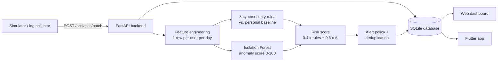
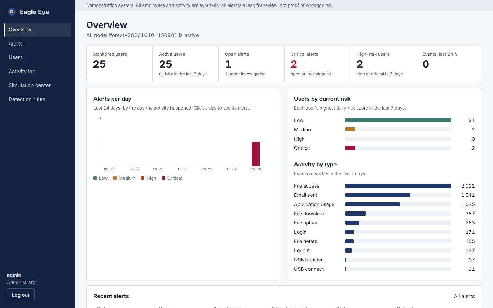
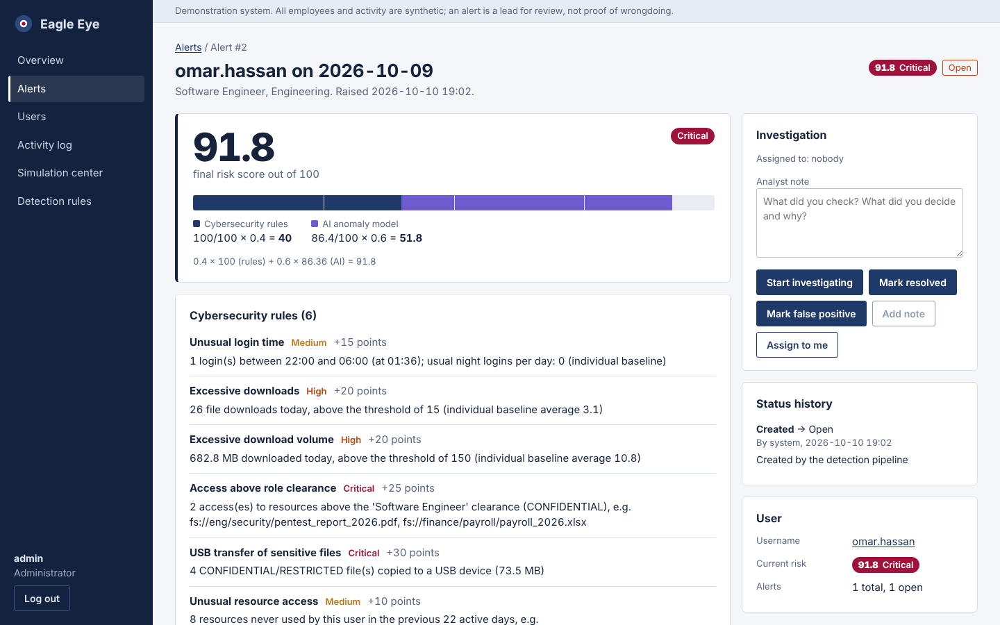
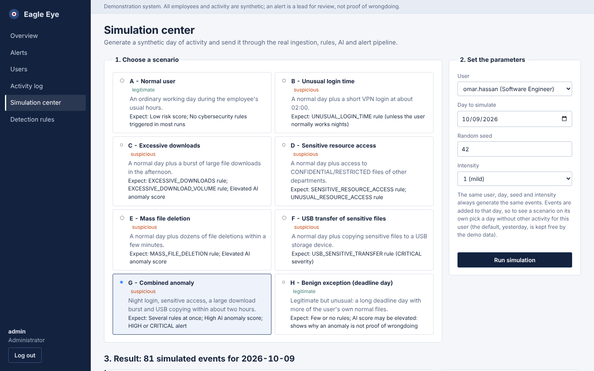

# Eagle Eye — AI-Powered Insider Threat Detection System

Graduation project. Eagle Eye analyzes the activity of (synthetic) employees, combines
**explicit cybersecurity rules** with an **Isolation Forest anomaly model**, turns both into an
explainable **risk score**, raises **alerts** for analysts, and shows them in a **web dashboard**
and an **Android (Flutter) app**.

> All employees, files and events in this project are synthetic. An alert means "this day
> deserves a human look", never "this person is malicious".

| Part | Technology | Folder |
|---|---|---|
| REST API, database, detection pipeline | Python 3.11+, FastAPI, SQLAlchemy, Alembic, SQLite | `backend/` |
| AI model | pandas, NumPy, scikit-learn Isolation Forest | `ai/` |
| Activity simulator | Python (standard library) | `simulator/` |
| Web dashboard (preserved legacy visual) | HTML, CSS, JavaScript | `legacy_frontend/` |
| Modular React dashboard (alternative client) | React 19, TypeScript, Vite | `frontend/` |
| Mobile app | Flutter / Dart | `mobile/` |
| Tests | pytest, Playwright, Node test runner, flutter_test | `tests/`, `frontend/src/utils/*.test.ts`, `mobile/test/` |
| Documentation | Markdown + Mermaid | `docs/`, this README, `VIVA_PREPARATION.md`, `CODE_EXPLANATION.md` |

Current status of every requirement: **[IMPLEMENTATION_STATUS.md](IMPLEMENTATION_STATUS.md)**.

## How it works in one picture



## Screenshots (synthetic demo data)

| Overview | Alert investigation | Simulation center |
|---|---|---|
|  |  |  |

## Quick start (Windows — one command per app)

Requirements: Python 3.11+, and for the mobile app Flutter 3.22+ plus Android Studio/Android SDK or a connected device. The first launch creates a virtual environment and installs Python packages; this may take several minutes.

- **Web + API:** double-click `RUN_WEB.bat`. It starts the modular FastAPI backend and serves the preserved old web design from the same server. Open `http://127.0.0.1:8000/dashboard/` (API docs: `http://127.0.0.1:8000/docs`).
- **Flutter mobile:** double-click `RUN_MOBILE.bat`, then choose Android Emulator, Windows Desktop, or a physical Android phone. It starts the API if needed, runs `flutter pub get`, and launches Flutter.

The launchers reuse the included demo database and trained Isolation Forest model. If you delete the database, the launcher prepares the schema and synthetic demo data again. Do not run this development server on a public network; for a physical phone, use a trusted Wi-Fi network and allow Python through Windows Firewall only if you intend to connect the phone.

For manual setup and integration details, see `docs/MERGED_INTEGRATION.md`.
### Demo logins (development only)

The included synthetic demo database uses `admin` / `EagleAdmin@2026!` (ADMIN) and `analyst` / `EagleAnalyst@2026!` (ANALYST). Do not use these demo credentials outside the local project. For real deployments, create new accounts with `python -m backend.cli create-account <username> --role ANALYST` or `--role ADMIN`; the command prompts for a password. Fresh demo seeding can read `DEMO_ADMIN_PASSWORD` and `DEMO_ANALYST_PASSWORD` from `.env`, or generate random credentials in `demo_credentials.txt` (git-ignored).
### Reset before a presentation

```bash
python scripts/reset_demo.py     # new empty database + demo data (keeps the trained model)
```

## Tests

```bash
pytest                                   # backend + AI + simulator + API + compatibility tests
python -m scripts.evaluate_detection     # whole-system evaluation on the synthetic test set
cd frontend && npm test                  # frontend unit tests (7)
cd frontend && npm run build             # type-check + production build
RUN_E2E=1 pytest tests/e2e -v            # browser tests (API + dashboard must be running)
cd mobile && flutter test                # Flutter tests
```

Results from the last verified run are in [docs/TESTING.md](docs/TESTING.md).

## Demonstration

The 10-minute presentation flow (normal day, suspicious day, investigation, mobile) is in
**[docs/DEMO_SCRIPT.md](docs/DEMO_SCRIPT.md)**.

## Documentation map

| Document | What it covers |
|---|---|
| [docs/PROJECT_OVERVIEW.md](docs/PROJECT_OVERVIEW.md) | Goals, scope, ethics, what the system does and does not do |
| [docs/ARCHITECTURE.md](docs/ARCHITECTURE.md) | Components, data flow, folder layout, design decisions |
| [docs/DATABASE_SCHEMA.md](docs/DATABASE_SCHEMA.md) | Tables, relationships, ER diagram |
| [docs/API_SPECIFICATION.md](docs/API_SPECIFICATION.md) | Every endpoint, roles, request/response examples, errors |
| [docs/AI_METHODOLOGY.md](docs/AI_METHODOLOGY.md) | Features, baseline, Isolation Forest, score mapping, evaluation |
| [docs/CYBERSECURITY_RULES.md](docs/CYBERSECURITY_RULES.md) | The 8 rules, thresholds, configuration |
| [docs/RISK_SCORING.md](docs/RISK_SCORING.md) | Risk formula, levels, alert policy, deduplication |
| [docs/TESTING.md](docs/TESTING.md) | Test suites and actual results |
| [docs/DEPLOYMENT.md](docs/DEPLOYMENT.md) | Installation, configuration, troubleshooting |
| [docs/USER_GUIDE.md](docs/USER_GUIDE.md) | How analysts use the dashboard and app |
| [docs/DEMO_SCRIPT.md](docs/DEMO_SCRIPT.md) | Step-by-step presentation |
| [docs/LIMITATIONS.md](docs/LIMITATIONS.md) | Known limitations and future work |
| [VIVA_PREPARATION.md](VIVA_PREPARATION.md) | Explanations and likely examiner questions |
| [CODE_EXPLANATION.md](CODE_EXPLANATION.md) | The most important files and functions |
| [data/README.md](data/README.md) | Dataset schema of the synthetic data |
| [docs/openapi.json](docs/openapi.json) | OpenAPI file (import into Postman: File > Import) |


## Updated SOC console and role access

Run `RUN_WEB.bat`. When Node.js/npm is available, the launcher starts the full React SOC console at `http://127.0.0.1:5173/` and the API at `http://127.0.0.1:8000/`. Without npm, it opens the built-in dashboard at `http://127.0.0.1:8000/dashboard/`.

Development demo logins: `admin` / `EagleAdmin@2026!` and `analyst` / `EagleAnalyst@2026!`. Admins manage users, accounts, rules, and activity data. Analysts can access Alerts and the Detection Lab, run synthetic scenarios, investigate alerts, add notes, and resolve alerts; the backend rejects admin-only API requests. See `docs/ROLE_ACCESS_MATRIX.md`.

## Real email delivery for password resets

Password-reset notifications use Gmail SMTP from the backend. To enable actual delivery:

1. Sign in to the real Gmail mailbox you want to send from.
2. Enable Google 2-Step Verification and create a Google **App Password** for this project.
3. Copy `.env.example` to `.env` if you have not already done so. Set `SMTP_USERNAME` and `SMTP_FROM_EMAIL` to the sender mailbox and put the App Password in `SMTP_PASSWORD`.
4. Keep `.env` private and out of version control, restart the backend, and test with real accounts that have registered email addresses.

A password-reset request triggers a notification to `ADMIN_EMAIL` (set this to the real administrator email). After an administrator approves, the temporary password is emailed to the real email address saved on the requesting login account. For an analyst account, this must be the analyst's actual Gmail address saved in Account Administration—not a placeholder or shared/fake address. `ANALYST_EMAIL` is only a notification contact and is not used as the reset recipient. The application will not approve a reset if SMTP delivery of the temporary password fails. Email delivery cannot work until valid SMTP credentials are supplied. The default email addresses are intentionally blank; configure real addresses in `.env`.


### Separate Admin and Analyst email accounts

The password-reset workflow can notify both the admin and analyst addresses. The admin account sends the primary notification and the temporary-password email to the account holder's registered address. The analyst notification uses a separate SMTP profile. To enable it, configure `SMTP_ANALYST_USERNAME`, `SMTP_ANALYST_FROM_EMAIL`, and `SMTP_ANALYST_PASSWORD` in your local `.env`. If the analyst SMTP profile is blank, analyst email delivery will be skipped while the admin workflow continues. Use newly generated App Passwords, never normal Gmail passwords, and never commit `.env`.

## Per-account permissions (development update)

The administrator's **Create account** form now allows selecting an `ADMIN` or a restricted `ANALYST` account and choosing explicit grants for the analyst account (`alerts.view`, `alerts.investigate`, `alerts.resolve`, `users.view`, `users.manage`, `activities.view`, `rules.manage`, `actions.escalate`). These grants are stored on the account through the existing `/api/v1/accounts` API. `ADMIN` remains full access to avoid accidental administrator lockout.

Important: the application currently has two supported login roles (`ADMIN` and `ANALYST`). The monitored employee's `job_role` is a separate concept and does not itself create an Eagle Eye login. Also, route-level enforcement is not yet uniformly migrated to each granular permission key; do not treat the checkbox catalogue as complete least-privilege enforcement until each protected endpoint is covered and tested. Frontend build verification in the current workspace requires installing the dependencies listed in `frontend/package.json` (`npm ci`).


## Account Job Roles and Permissions (development update)

Eagle Eye login accounts now distinguish the application access tier (`ADMIN` or `ANALYST`) from the business `job_role` (for example Software Engineer, IT Support, HR Specialist, Finance Specialist, or Security Analyst). The administrator selects the job role when creating an account and separately grants the account's API permissions. `ADMIN` remains a privileged application access tier; a job title alone does not grant admin access.

Existing databases are upgraded at API startup by adding the `accounts.job_role` column if it is missing. Use the normal project setup steps in this README and test against a backup of any existing database before using the development update. Frontend production build and Flutter runtime still need validation in an environment with their dependencies installed.
