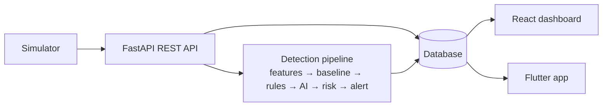

# Viva preparation

This document helps the team explain Eagle Eye to the examiners. Each section starts in plain
English and then introduces the technical terms. Every statement here describes what the code
actually does; file names point to where to look.

---

## 1. The system in two minutes

**Plain English.** Companies trust their employees with data. Sometimes that trust is misused: someone
copies customer lists to a USB stick before resigning, or logs in at 2 a.m. and downloads files they never
touch. Eagle Eye watches *work activity* (logins, file use, downloads, USB, e-mail counts), learns what a
normal day looks like for each person, and tells a security analyst when a day looks suspicious, with
an explanation. It never accuses or blocks anyone; a human decides.

**Technically.** A FastAPI backend ingests activity events through a REST API, stores them in SQLite via
SQLAlchemy, aggregates each user-day into 15 features, evaluates 8 explicit rules against a per-user
statistical baseline, scores the day with a scikit-learn Isolation Forest, combines both into a 0-100 risk
score, and creates deduplicated alerts. A React/TypeScript dashboard and a Flutter app consume the same
JWT-protected API. All data is synthetic, produced by a seeded simulator.

## 2. Architecture

* **Modular monolith**: one backend program split into modules (`routers/`, `detection/`, `ingestion.py`,
  `security.py`). We avoided microservices because they add network failures and deployment work without
  benefit at our size.
* **Single source of truth**: the backend computes everything; the web and mobile apps only display data
  and send analyst actions. They contain no detection logic.
* **Layers**: routers (HTTP, validation, permissions) → services (ingestion, pipeline) → models (database).

## 3. How an employee activity becomes an alert (step by step)

1. **Event arrives**: `POST /api/v1/activities/batch` with events such as
   `{"user_id": 1, "timestamp": "2026-10-09T01:36:00", "event_type": "LOGIN", ...}` (`backend/routers/activities.py`).
2. **Validation**: Pydantic checks types and allowed values (event type, sensitivity), that a file event has a
   resource, sizes are not negative (`backend/schemas.py`). Invalid input → HTTP 422.
3. **Storage**: `ingest_activities` checks the users exist, rejects future timestamps, saves the events,
   updates devices and the user's last activity (`backend/ingestion.py`).
4. **For each affected user-day** `analyze_user_day` runs (`backend/detection/pipeline.py`):
   1. load all events of that user on that day;
   2. **features**: count logins, night logins, downloads, MB, deletions, USB… (`ai/features.py`);
   3. **baseline**: mean and standard deviation of those features over the user's previous 30 days
      (or department, or defaults) (`backend/detection/baseline.py`);
   4. **rules**: 8 checks, each returns a reason and points (`backend/detection/rules.py`);
   5. **AI**: Isolation Forest gives an anomaly score 0-100 (`ai/model.py` via `anomaly_service.py`);
   6. **risk**: 0.4 × rules + 0.6 × AI, critical-rule floor, level LOW…CRITICAL (`backend/detection/risk.py`);
   7. **save** the result as the user's risk for that day (`analysis_results`);
   8. **alert policy**: if risk ≥ 50, create an alert or update the existing one for that day
      (`backend/detection/alerts.py`).
5. **Display**: the dashboard and the app read `/alerts`, `/alerts/{id}`, `/dashboard/*`.
6. **Investigation**: the analyst changes the status with a note (`PATCH /alerts/{id}`); history and audit are recorded.

## 4. Components and how they communicate

| Component | Responsibility | Talks to |
|---|---|---|
| Simulator (`simulator/`) | Generates realistic, labeled synthetic days (scenarios A-H) from a seed | Backend in-process (`/simulator/run`) or over HTTP (`simulator/cli.py`) |
| Backend API (`backend/`) | Validation, authentication, roles, storage, detection, alerts | Database (SQLAlchemy), AI package (Python import) |
| AI package (`ai/`) | Features, training, model file, inference | Loaded by the backend once at start-up |
| Database | Persistent state | Backend only |
| Web dashboard (`frontend/`) | Analyst UI | Backend via HTTPS/HTTP JSON + JWT |
| Flutter app (`mobile/`) | Mobile analyst UI | Backend via HTTP JSON + JWT |

## 5. Database

Main tables (`backend/models.py`, diagram in `docs/DATABASE_SCHEMA.md`):

* `accounts`: people who log in (ADMIN/ANALYST), password **hashes** only.
* `monitored_users`: synthetic employees; no passwords; their current risk.
* `activities`: every event (user, time, type, resource, sensitivity, size, device, source, simulated flag).
* `analysis_results`: one row per user per day: features, rules, AI score, risk (the risk history).
* `alerts`: one alert per user-day at most while active; links to evidence activities (`alert_activities`).
* `alert_history`: every status change and note with who and when.
* `behavioral_profiles`, `devices`, `audit_logs`, `rule_settings`, `model_versions`.

Relationships: a monitored user has many activities, analysis results and alerts; an alert has many
history entries and many evidence activities (many-to-many). Users cannot be deleted while they have
history (`RESTRICT`), so evidence is never lost.

## 6. Important API endpoints

| Endpoint | Purpose |
|---|---|
| `POST /auth/login` | Returns a JWT token |
| `POST /activities/batch` | Ingestion; triggers detection (admin) |
| `GET /alerts`, `GET /alerts/{id}` | Alert queue and full investigation view |
| `PATCH /alerts/{id}` | Status change / note / assignment |
| `GET /dashboard/summary` and charts | Overview numbers |
| `GET /users/{id}`, `/risk-history` | Baseline and daily risk |
| `POST /simulator/run` | Demo data through the real pipeline (admin) |
| `GET/PATCH /rules` | View / configure rules |
| `GET /models/status` | Which model is loaded and its evaluation |

Swagger at `/docs` shows all 27 endpoints with their schemas.

## 7. The AI pipeline for beginners

**What is an anomaly?** Something that differs a lot from what usually happens. If you normally download
3 files a day and today you downloaded 60 at 2 a.m., that day is an anomaly. An anomaly is *rare*, not
necessarily *bad*: a deadline day is also rare.

**What does the model see?** For each user-day, 15 numbers (features): total events, logins, night logins,
night events, active hours, file accesses, sensitive accesses, downloads, MB downloaded, uploads, deletions,
USB events, sensitive USB transfers, e-mails, distinct resources.

**How does Isolation Forest work?** Imagine separating one day from all others by asking random yes/no
questions like "downloads > 17?". A strange day gets isolated after very few questions; an ordinary day is
surrounded by similar days and needs many questions. The model builds 200 random "question trees" on normal
days; the average number of questions needed for a new day becomes its score. Few questions → unusual.

**From model output to 0-100.** scikit-learn returns a raw score (higher = more unusual after we negate it).
We take two reference values from the training days: the *typical* raw score (median) and the *threshold*
(the 99th percentile, so 1% of normal days lie above it). Then
`anomaly score = 50 × (raw − typical) / (threshold − typical)`, limited to 0-100. So 0 = a typical day,
50 = the model's boundary of normal, 100 = far beyond it. **It is not a probability** that someone is malicious.

**Training.** `python -m ai.train` generates 90 days of synthetic behavior for 40 employees, trains on the
first 60 (normal only) and tests on the last 30, where 10% of user-days were replaced by suspicious or
unusual scenarios. Seeds are fixed, so training is reproducible. The model file and its metadata (version,
features, thresholds, metrics) are saved in `ai/models/`.

**Inference.** The backend loads the model once; each analysis calls `detector.predict(features)`. If no
model exists, the system still works with rules only and says "AI unavailable"; it never invents an AI score.

**Results (synthetic test period).** AI alone: precision 0.62, recall 0.52, false-positive rate 3%. It catches
all combined attacks but also flags most benign deadline days. Full system (rules + AI + alert threshold):
precision 1.00, recall 0.60, no false alarms on 805 normal days. These numbers are on our own synthetic data
and are optimistic; they prove the pipeline works, not real-world accuracy.

## 8. Cybersecurity rules and risk scoring

**Rules** (`backend/detection/rules.py`): unusual login time, excessive downloads, excessive download
volume, access above role clearance, mass file deletion, USB transfer of sensitive files, unusual (never
used before) resources, abnormally high activity. Most compare today's number with
`max(minimum, mean + 3 × std)` of the user's own history: a personal threshold with a sensible floor.
Each finding has an ID, severity, points and a sentence with the actual numbers.

**Rule score** = sum of points of fired rules, capped at 100.

**Risk score** = 0.4 × rule score + 0.6 × AI score. If a CRITICAL rule fired (sensitive USB copy, access
above clearance) the risk is at least 50, so a clear policy violation is never hidden by a low AI score.
Levels: <25 LOW, <50 MEDIUM, <75 HIGH, ≥75 CRITICAL. Alert when risk ≥ 50.

**Deduplication**: one alert per user per day; new events for the same day update the open alert;
a closed alert is only followed by a new one when something new appears (new rule or higher level).

## 9. Frontend and Flutter

**Web** (`frontend/src`): React components in TypeScript. `api/client.ts` adds the token to every request and
turns errors into messages; `useApi.ts` handles loading/error states; pages for overview, alerts, alert
details, users, user details, activity log, simulation center and rules. Charts are small SVG components
(no chart library) so they are easy to explain and sharp on a projector. Navigation uses URL hashes
(`#/alerts/12`). Important changes ask for confirmation.

**Flutter** (`mobile/lib`): `api_client.dart` (HTTP + JSON), `models.dart` (the same fields as the API),
`auth_state.dart` (login state with Provider, token in encrypted storage), screens for login, overview,
alerts, alert details with status changes, user risk and profile. It handles loading, empty, offline and
error states and supports pull-to-refresh.

## 10. Security measures

* Passwords hashed with **scrypt** (memory-hard, random salt); never stored or returned in plain text.
* **JWT** tokens signed with a secret from `.env`, 60-minute expiry; checked on every request.
* **Roles**: ADMIN and ANALYST, enforced on each endpoint (403 otherwise); anonymous → 401.
* **Input validation** on every field; page sizes limited; batch size limited.
* **Brute-force protection**: 5 failed logins in 5 minutes → 429; same error text for wrong user and wrong password.
* **CORS** limited to the dashboard's origin; security headers; generic error messages (no stack traces).
* **Audit log** for logins, ingestion, simulations, rule changes and alert updates; no secrets logged.
* Demo passwords are generated, never committed; `seed-demo` is disabled in production mode.

---

## 11. Likely viva questions and answers

**Q1. Why combine rules and AI? Isn't one enough?**
Rules are precise and explainable but only find what we anticipated. The AI finds unusual days we did not
describe but cannot say *why* and also flags harmless unusual days. Our evaluation shows exactly that: the
AI alone flagged 14 of 16 benign deadline days; combined with rules and a threshold, none raised an alert,
while every combined attack still did.

**Q2. Is your AI really AI, or just if-statements?**
The rules are if-statements, deliberately. The anomaly part is a trained machine-learning model
(scikit-learn Isolation Forest, 200 trees) learned from 1,680 normal user-days, saved to a file with a
version and loaded for inference. You can see it in `ai/model.py` and its metrics at `GET /models/status`.

**Q3. Why Isolation Forest and not a neural network or a classifier?**
We have no real labeled attacks, so supervised classifiers would learn our own invented labels. Isolation
Forest is unsupervised, works well on small tabular data, trains in seconds, has few settings, and its idea
(isolate points with random splits) is easy to explain. An autoencoder would need more data and tuning.

**Q4. What does an anomaly score of 80 mean?**
That the day is much more isolated than normal training days: beyond the 99th-percentile boundary (50) and
most of the way to twice that distance (100). It does not mean an 80% chance of guilt.

**Q5. How did you choose the threshold?**
The 99th percentile of raw scores on normal training days, i.e. we accept that about 1% of ordinary days look
unusual to the model. It is a documented, adjustable choice that trades false alarms against missed cases.

**Q6. How do you avoid data leakage?**
(a) Time-aware split: trained on days 1-60, tested on days 61-90. (b) The baseline for a day uses only
earlier days, so a suspicious day cannot raise its own threshold. (c) The model is never retrained on
evaluation days.

**Q7. What happens for a brand-new employee with no history?**
The system says so: it uses the department's history (PEER_GROUP) or documented defaults (DEFAULT), shows
which one, and skips the "never used before" rule. Our end-to-end test checks that a new user's normal day
does not produce a critical alert.

**Q8. Why 0.4 for rules and 0.6 for AI?**
It was the specification's starting point. We kept it because the clearest policy violations are protected
by the critical-rule floor, so the AI weight mainly decides between ambiguous days. The weights are settings,
and the breakdown shows both parts so the analyst is not misled by the combination.

**Q9. How do you prevent alert floods?**
One alert per user per day. New events for the same day update the open alert (`occurrence_count`), and a
closed alert is only re-raised when a new rule fires or the level rises.

**Q10. How are passwords and tokens protected?**
scrypt hashes with random salts; JWT signed with a secret from the environment, 60-minute expiry; the
mobile app keeps the token in the Android Keystore; the web keeps it in sessionStorage (cleared when the
tab closes). Wrong-password and unknown-user answers are identical and rate-limited.

**Q11. Can an analyst be wrong? What then?**
Yes. Decisions need a note, everything is in the history and audit log, and a closed alert can be reopened.
The system never acts on its own.

**Q12. What are the ethical concerns?**
Privacy and trust. We only use activity metadata (no contents), all data is synthetic, the UI repeats that
an alert is not proof, and a real deployment would need a legal basis, employee information, retention limits
and restricted access to alerts.

**Q13. How would this scale to a real company?**
Move analysis to background workers, use PostgreSQL, collect events from real sources (Windows event logs,
DLP, proxies), retrain the model on real normal behavior, add HTTPS, MFA and a stronger session design.

**Q14. Why did the excessive-downloads scenario not always raise an alert?**
In some runs the burst triggers the rules (40 points → 16 risk) but the AI score stays moderate, so the total
stays under 50 (MEDIUM). It is recorded in the risk history but not escalated. Lowering the alert threshold
or raising download-rule weights would change that; it is a trade-off with false alarms.

**Q15. What does the night-shift technician show?**
Personal baselines: `khaled.ramy` logs in at about 01:00 every day, so his baseline contains night logins and
the unusual-login rule does not fire for him, while it fires for a day worker.

**Q16. How do the web and mobile apps stay consistent?**
They call the same endpoints and display the backend's numbers. The browser test changes an alert status in the
web UI and checks it through the API; the mobile app reads the same `GET /alerts/{id}`.

**Q17. How did you test it?**
85 automated Python tests (rules, features, AI, risk, API, security, end-to-end scenario), 7 frontend unit tests,
4 browser tests on the real running system, and 12 Flutter tests (written; not run in our build environment
because the Flutter SDK was not available there; run `flutter test`).

**Q18. What would you improve first?**
Evaluate on an independent dataset (e.g. CERT), add per-feature explanations of the AI score, and learn
thresholds from analysts' false-positive decisions.

## 12. Limitations, trade-offs, future work

See `docs/LIMITATIONS.md`. In one breath: synthetic data and self-designed scenarios, daily window only,
one global model, static weights, synchronous processing, SQLite, demo-level session security, no push
notifications, Flutter not yet executed by us.

## 13. Presentation script (5 minutes, short version of docs/DEMO_SCRIPT.md)

1. *"Eagle Eye detects suspicious behavior of trusted users and explains why, without accusing anyone."* Show the overview.
2. *"Every number comes from synthetic activity processed by the real pipeline."* Open a user's baseline.
3. Simulation center → **Normal user** → LOW. *"Normal day, small AI score, no rules."*
4. Simulation center → **Combined anomaly** for omar.hassan → CRITICAL. Read the formula aloud.
5. Open the alert: rules with reasons, AI box, evidence timeline. *"An analyst sees exactly why."*
6. Start investigating (confirm), then show the same alert on the phone and resolve it with a note.
7. Close with the honest limits: synthetic data, the benign deadline day that the AI flags, a human decides.

Who presents what (suggestion): architecture and backend (member 1), AI (member 2), rules and risk
(member 3), web and mobile (member 4), testing and limitations (team leader).
