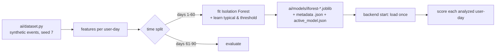

# AI methodology

Code: `ai/features.py`, `ai/model.py`, `ai/train.py`, `ai/dataset.py`, `ai/evaluate.py`,
`backend/detection/baseline.py`, `backend/detection/anomaly_service.py`.
Experiment notebook: `ai/notebooks/model_evaluation.ipynb`.

## 1. What problem the AI solves

Rules catch patterns we can describe in advance ("sensitive file copied to USB"). They cannot
catch a day that is strange in a way nobody wrote a rule for. The AI part answers a different
question: **"How different is this user-day from the normal days the model has seen?"** That
is *anomaly detection*: learning what normal looks like, then measuring distance from it.
It is **unsupervised**: the model is trained on normal days only and never sees a labeled attack.

## 2. Features (one row per user per day)

Aggregation window: one calendar day of one user, in local organization time. The same function
(`compute_daily_features`) is used for training, live detection and the rules.

| Feature | Type | Definition |
|---|---|---|
| `total_events` | count | events of any type |
| `login_count` | count | LOGIN events |
| `night_login_count` | count | LOGIN between 22:00 and 05:59 |
| `night_event_count` | count | any event between 22:00 and 05:59 |
| `unique_active_hours` | count | distinct clock hours with ≥ 1 event |
| `file_access_count` | count | FILE_ACCESS events |
| `sensitive_access_count` | count | file/USB events on CONFIDENTIAL or RESTRICTED resources |
| `download_count` | count | FILE_DOWNLOAD events |
| `download_mb` | float | sum of downloaded `file_size_bytes` / 1,048,576 |
| `upload_count` | count | FILE_UPLOAD events |
| `delete_count` | count | FILE_DELETE events |
| `usb_event_count` | count | USB_CONNECT + USB_TRANSFER |
| `usb_sensitive_transfer_count` | count | USB_TRANSFER of CONFIDENTIAL/RESTRICTED files |
| `email_count` | count | EMAIL_SENT events |
| `unique_resources` | count | distinct resources touched by file/USB events |

**Missing values:** a missing file size counts as 0 MB; a missing resource is not counted as a
resource. A day without events is not analyzed. Before inference, `validate_feature_vector`
rejects missing features, non-numbers, NaN and negative values (the pipeline then marks the AI
part as unavailable instead of guessing). The feature list is versioned
(`FEATURE_SCHEMA_VERSION = "1.0"`); a model trained with another version is refused at load time.

**Transformations:** none. We tested a `log(1 + x)` transform of the counts; on our test period it
lowered recall from 0.52 to 0.29 at a similar false-positive rate, because it compresses exactly
the extreme values we want to isolate. Isolation Forest does not need feature scaling (it splits
each feature between its own min and max).

## 3. Behavioral baseline

For the rules (and the analyst's view), each user has a baseline: the mean and standard
deviation of every feature over **previous** days.

1. **INDIVIDUAL** if the user has ≥ 7 active days in the 30 days before the analyzed day.
2. **PEER_GROUP** otherwise, from ≥ 20 user-days of colleagues in the same department.
3. **DEFAULT** otherwise: documented generous values in `rule_config.py`.

The analyzed day is never part of its own baseline (no leakage of future information), and the
dashboard always says which baseline type was used, so we never pretend a personal baseline exists
when it does not. The "unusual resource" rule only runs with an INDIVIDUAL baseline.

## 4. Isolation Forest

**Idea.** Build many random trees. Each tree picks a random feature and a random split value,
again and again, until every user-day is alone in a leaf. A very unusual day (e.g. 60 downloads
when others have 2-6) is separated after a few splits; an ordinary day sits among many similar
ones and needs many splits. The average **path length** over all trees is therefore short for
anomalies and long for normal points.

**Settings.** `IsolationForest(n_estimators=200, contamination="auto", random_state=42)`, each tree
built from 256 sampled rows (scikit-learn default). `contamination` only affects scikit-learn's own
`predict()`, which we do not use; our threshold is explained below.

**Training data.** Synthetic, see [data/README.md](../data/README.md): 40 employees, 90 days,
weekends skipped. Days 1-60 (1,680 user-days, normal only) are used for training.

**Why Isolation Forest?** Unsupervised (we have no real labeled attacks), fast on small tabular
data, few hyper-parameters, and a well-known paper (Liu, Ting & Zhou, 2008) the team can cite.
Alternatives considered: One-Class SVM (needs scaling and kernel tuning, slower), autoencoders
(more data and tuning, harder to explain), simple z-scores (one feature at a time, misses
combinations).

## 5. From model output to the anomaly score

| Concept | Where | Meaning |
|---|---|---|
| raw score | `raw = -model.score_samples(x)` | about 0.44 for a typical day; higher = more isolated |
| typical | median raw score on training days | 0.4422 for model `iforest-20261010-150901` |
| threshold | 99th percentile of raw scores on training days | 0.5956 for the same model |
| anomaly score | `50 × (raw − typical) / (threshold − typical)`, clipped to 0…100 | 0 = typical or more normal, 50 = the model's anomaly boundary, 100 = twice as far beyond typical as the boundary |
| is_anomaly | `raw > threshold` | the same as anomaly score > 50 |

The mapping is linear, deterministic and stored with the model (`calibration` in the metadata
JSON), so the same day always gets the same score from the same model. **The anomaly score is not
a probability** of malicious behavior: it measures distance from normal behavior. By construction
about 1% of normal training days are above 50.

## 6. Training and inference workflow

* Train: `python -m ai.train` (seeded, reproducible: same data and same scores every run).
* The backend loads the active model at start-up (or via `POST /models/reload`), records it in
  `model_versions`, and never retrains during requests.
* No model? The backend still starts; analyses use rules only with `ai_status = "UNAVAILABLE"`
  and a message. No random or hard-coded AI output is ever produced.

## 7. Evaluation (synthetic data, time-aware split)

Test period: last 30 days, 880 user-days, of which 75 are suspicious scenario days and 805 are
normal or benign-exception days. All numbers below are produced by `python -m ai.train` and
`python -m scripts.evaluate_detection` (they are identical on every run with the default seeds).

| Detector | Precision | Recall | F1 | False-positive rate | TP / FP / FN / TN |
|---|---|---|---|---|---|
| AI model only (anomaly score > 50) | 0.619 | 0.520 | 0.565 | 0.030 | 39 / 24 / 36 / 781 |
| Rules only (any rule fired) | 1.000 | 0.933 | 0.966 | 0.000 | 70 / 0 / 5 / 805 |
| Full system (alert raised, risk ≥ 50) | 1.000 | 0.600 | 0.750 | 0.000 | 45 / 0 / 30 / 805 |

Flagged / total per scenario:

| Scenario | AI only | Rules only | Full system alert |
|---|---|---|---|
| Normal day | 10 / 789 | 0 / 789 | 0 / 789 |
| Benign exception (deadline day) | 14 / 16 | 0 / 16 | 0 / 16 |
| Unusual login | 0 / 6 | 6 / 6 | 0 / 6 |
| Excessive downloads | 11 / 17 | 13 / 17 | 6 / 17 |
| Sensitive access | 2 / 9 | 8 / 9 | 6 / 9 |
| Mass deletion | 8 / 15 | 15 / 15 | 5 / 15 |
| USB transfer | 4 / 14 | 14 / 14 | 14 / 14 |
| Combined anomaly | 14 / 14 | 14 / 14 | 14 / 14 |

**How to read this honestly**

* The rules look almost perfect because **we wrote both the rules and the scenarios**; real attacks
  will not be shaped to match our rules. Treat the rule numbers as a consistency check, not a result.
* The AI alone finds every combined attack and most download bursts, but also flags 14 of 16 benign
  deadline days: an unusual day is not a malicious day. That is the main lesson of the project.
* The full system is deliberately conservative: a single weak signal (one night login) becomes a
  MEDIUM risk in the analysis history but does not raise an alert. Lowering `ALERT_THRESHOLD`
  raises recall and analyst workload.
* The evaluation in `scripts/evaluate_detection.py` uses each user's individual history from the
  synthetic dataset; peer-group fallbacks are exercised by the live system and the tests.
* Nothing here measures real-world performance. That would need real, consented, labeled data.

## 8. Limitations of the AI part

* Trained on synthetic behavior; would need retraining on real normal behavior.
* One global model for all users: personalization comes from the rules' baselines, not the model.
* Daily granularity: an attack spread over many days with small daily amounts is not visible.
* Drift: when normal work changes (new tools, new projects), the model must be retrained.
* The anomaly score explains *how unusual*, not *which feature* made it unusual; analysts use the
  rules, the baseline table and the evidence timeline for that.
