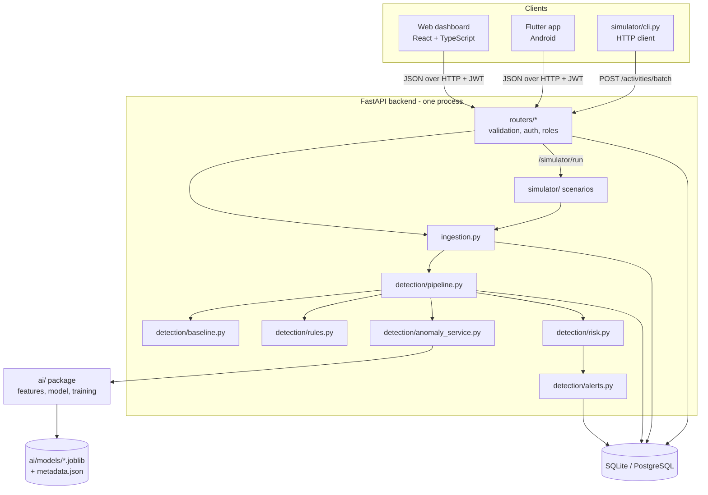
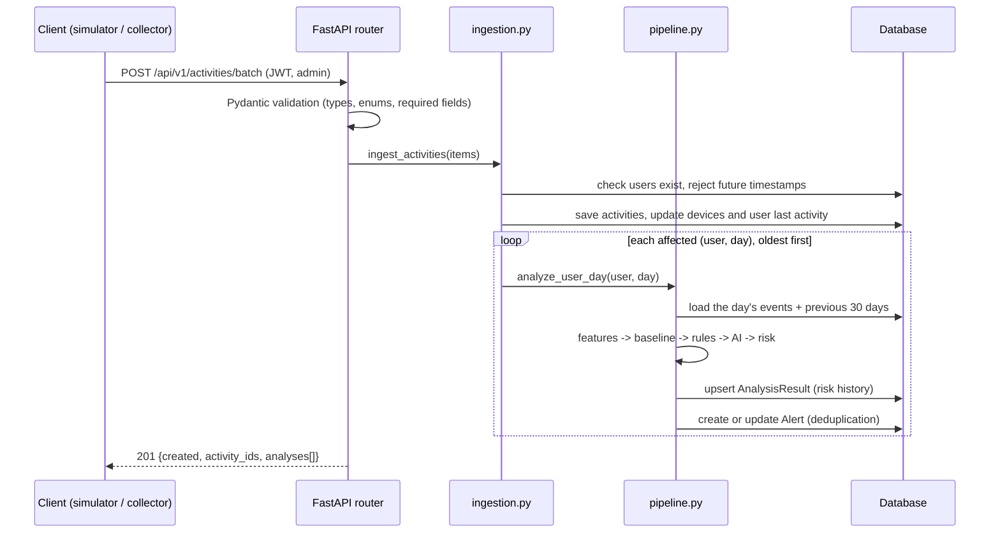

# Architecture

Eagle Eye is a **modular monolith**: one backend process with clearly separated modules,
one database, and two thin clients. Microservices would add network calls, deployment work and
failure points without any benefit at this size.

## Components



## From an event to an alert



## Folder layout

```
eagle-eye/
├── ai/                    AI: features.py, model.py, train.py, dataset.py, evaluate.py, notebooks/
├── backend/               FastAPI app
│   ├── main.py            app, CORS, security headers, error handler, routers
│   ├── config.py          settings from .env
│   ├── database.py        SQLAlchemy engine/session
│   ├── models.py          database tables
│   ├── schemas.py         API contract (Pydantic)
│   ├── security.py        password hashing, JWT, roles, login rate limit
│   ├── ingestion.py       store events, trigger analysis
│   ├── serializers.py     database rows -> API responses
│   ├── detection/         baseline, rules, anomaly_service, risk, alerts, pipeline, rule_config
│   ├── routers/           one file per API area
│   ├── migrations/        Alembic migrations
│   └── cli.py             init-db, create-account, seed-demo, export-openapi
├── simulator/             catalog (fake company), generator, scenarios A-H, cli (HTTP client)
├── frontend/              React + TypeScript + Vite dashboard
├── mobile/                Flutter app
├── tests/                 pytest suites (+ tests/e2e browser tests)
├── scripts/               setup, reset, evaluation, .env creation
├── data/                  dataset documentation (generated files are git-ignored)
└── docs/                  this documentation
```

## Key design decisions

| Decision | Why |
|---|---|
| One shared feature function (`ai/features.py`) | Training and live detection compute features identically, so the model never sees differently-defined inputs |
| Analysis window = 1 user-day | Matches how analysts think ("what did Omar do yesterday?"), gives the model enough events per row, and makes deduplication natural |
| Baseline from days *before* the analyzed day | Prevents the suspicious day from raising its own threshold (no future leakage) |
| Rules and AI produce separate scores | The analyst can see which part of the score came from which signal |
| Model loaded once, trained offline | Fast requests; reproducible model versions; no retraining per request |
| Backend works without a model | Missing model -> rules only, clearly marked `ai_status: UNAVAILABLE`, never fake AI output |
| SQLite by default, SQLAlchemy everywhere | Zero setup for the demo; PostgreSQL works by changing `DATABASE_URL` |
| Hash-based routing and hand-drawn SVG charts in the web app | Fewer dependencies to install and explain; charts stay sharp on a projector |
| Same API for web and Flutter | One source of truth; no business logic in clients |

## Time handling

Activity timestamps are stored as **local organization time** (`ORG_TIMEZONE`, default
Africa/Cairo) because "night" and "day" are defined by the local clock. Timestamps that arrive
with a timezone are converted. System timestamps (alert creation, logins to Eagle Eye) are stored
in UTC and sent with a `Z` suffix so each client shows them in its own local time.

## Security architecture

See [API_SPECIFICATION.md](API_SPECIFICATION.md#authentication-and-roles) and
`backend/security.py`: scrypt password hashes, signed JWT (HS256) with expiry, role checks on
every route, login rate limiting, input validation on every field, pagination limits, CORS
restricted to configured origins, security headers, generic 500 errors (no stack traces),
and an audit log of logins, ingestion, simulations, rule changes and alert updates.
