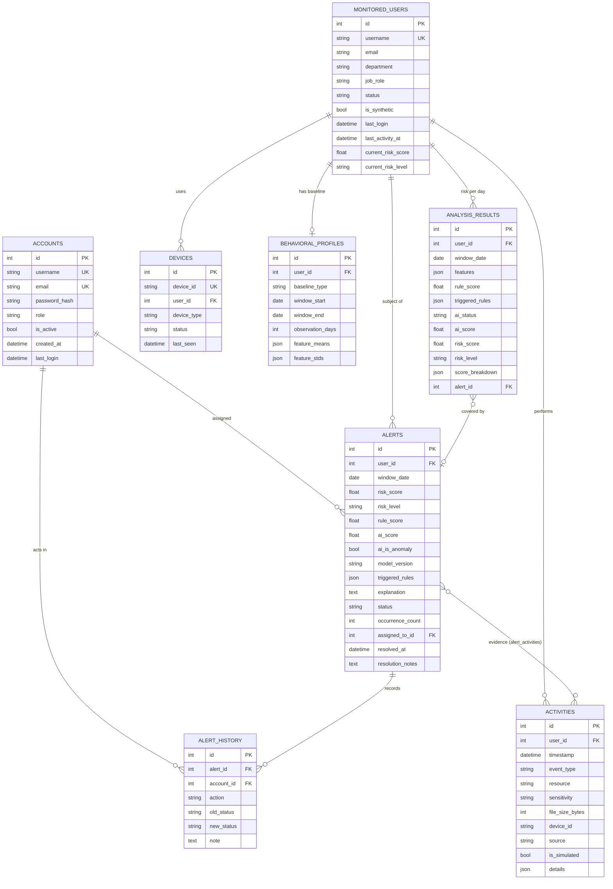

# Database schema

Defined in `backend/models.py`; created by the Alembic migration in
`backend/migrations/versions/` (`python -m backend.cli init-db`).

## ER diagram

Not drawn: `audit_logs` (actor, action, entity, details, time), `rule_settings` (rule_id,
enabled, weight, parameters) and `model_versions` (version, algorithm, training dataset,
trained_at, feature schema version, metrics, artifact path, status). They have no foreign keys.

## Tables

| Table | One row is | Notes |
|---|---|---|
| `accounts` | A login of Eagle Eye (ADMIN or ANALYST) | Only table with password hashes (scrypt) |
| `monitored_users` | A (synthetic) employee being monitored | No password; `current_risk_*` = highest daily risk in the last 7 days |
| `activities` | One event | Indexed by user, timestamp, event type. `is_simulated` marks simulator data |
| `devices` | A workstation or USB device seen in events | Created automatically during ingestion |
| `behavioral_profiles` | The latest baseline of a user | Updated in place after each analysis |
| `analysis_results` | Detection result for one user-day | Unique (user_id, window_date): re-analysis updates the row. This is the risk history |
| `alerts` | An alert for one user-day | At most one active alert per user-day (deduplication) |
| `alert_activities` | Link alert ↔ evidence activity | Many-to-many, cascade on delete |
| `alert_history` | One change to an alert | CREATED, UPDATED_BY_DETECTION, STATUS_CHANGED, NOTE_ADDED, ASSIGNED, UNASSIGNED |
| `audit_logs` | One action in Eagle Eye | LOGIN, LOGIN_FAILED, ACTIVITIES_INGESTED, SIMULATION_RUN, RULE_UPDATED, ALERT_UPDATED, ... |
| `rule_settings` | Configuration of one rule | Seeded from `backend/detection/rule_config.py` |
| `model_versions` | A trained model that was loaded | Older versions are marked RETIRED |

## Consistency rules

* Activities and alerts reference users with `ON DELETE RESTRICT`: a user with history cannot be
  deleted by accident (users are deactivated with `status`, not deleted).
* Profiles and analysis results cascade with the user; alert history and evidence links cascade
  with the alert.
* SQLite enforces foreign keys because `backend/database.py` switches them on for every connection.
* Stored JSON (features, rules, breakdown) is a snapshot of the analysis at that moment, so an
  alert still explains itself even if rule settings change later.

## Sensitive data

No message contents, keystrokes or personal data beyond a username, department, role and an
optional work e-mail are stored for monitored users. Passwords exist only as scrypt hashes for
Eagle Eye accounts. Tokens are never stored on the server.
