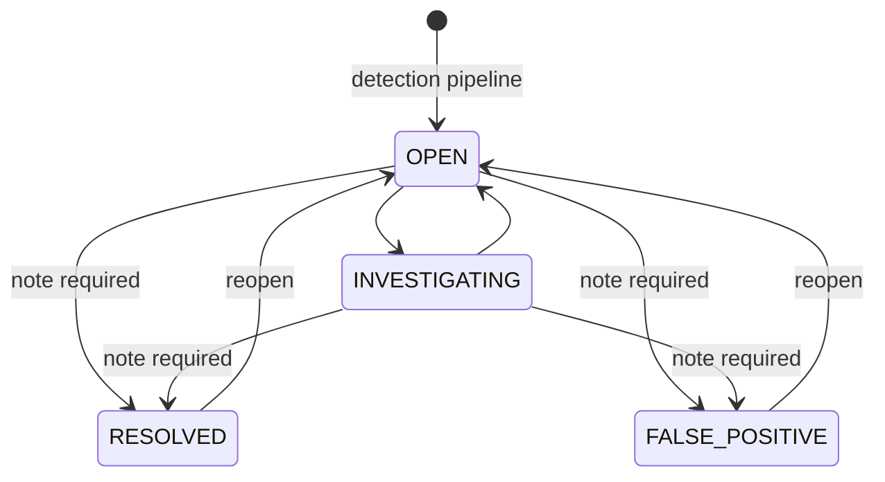

# Risk scoring and alerting

Code: `backend/detection/risk.py`, `backend/detection/alerts.py`, `backend/detection/pipeline.py`.

## Inputs (all on a 0-100 scale)

| Input | Source |
|---|---|
| Rule score | sum of triggered rule weights, capped at 100 ([CYBERSECURITY_RULES.md](CYBERSECURITY_RULES.md)) |
| AI anomaly score | Isolation Forest mapping, 50 = model's anomaly boundary ([AI_METHODOLOGY.md](AI_METHODOLOGY.md#5-from-model-output-to-the-anomaly-score)) |

## Formula

    final = RISK_RULE_WEIGHT × rule_score + RISK_AI_WEIGHT × ai_score          (defaults 0.4 and 0.6)

Two documented adjustments:

1. **AI unavailable** (no trained model, or invalid features): `final = rule_score`. The analysis is
   marked `ai_status = UNAVAILABLE` and the formula text says so.
2. **Critical-rule floor**: if a CRITICAL rule fired (`USB_SENSITIVE_TRANSFER` or
   `SENSITIVE_RESOURCE_ACCESS`), `final` is raised to at least the HIGH boundary (50).

Why the floor? With weights 0.4/0.6, one critical policy violation on an otherwise ordinary day
(rule score 30, AI score ~0) would give 12 → LOW, which would hide a clear exfiltration signal.
The floor is visible in the breakdown (`critical_floor_applied`) and as a striped segment in the
dashboard's breakdown bar.

Why 0.6 for the AI? The rules already have their own floor for the clearest violations; the
weight lets broad, multi-signal unusual behavior (which the rules may only partly describe)
dominate. The weights are settings and must add up to 1.0 (checked at start-up).

## Risk levels (configurable)

| Score | Level |
|---|---|
| 0 - 24.9 | LOW |
| 25 - 49.9 | MEDIUM |
| 50 - 74.9 | HIGH |
| 75 - 100 | CRITICAL |

`RISK_MEDIUM_MIN`, `RISK_HIGH_MIN`, `RISK_CRITICAL_MIN` in `.env`.

## Worked examples (real outputs from the demo)

| Day | Rules | AI | Calculation | Result |
|---|---|---|---|---|
| Normal day (mona.adel) | 0 | 26.5 | 0.4·0 + 0.6·26.5 | 15.9 LOW, no alert |
| Single night login (karim.fathy) | 15 | 9.8 | 0.4·15 + 0.6·9.8 | 11.9 LOW, no alert |
| Deadline day, benign (dina.khaled) | 0 | 67.8 (anomalous) | 0.4·0 + 0.6·67.8 | 40.7 MEDIUM, no alert |
| Download burst (salma.ibrahim) | 40 | 66.6 | 0.4·40 + 0.6·66.6 | 55.9 HIGH, alert |
| USB copy of sensitive files (heba.yasser) | 55 | 28.0 | 0.4·55 + 0.6·28.0 = 38.8 → floor | 50 HIGH, alert |
| Combined attack (omar.hassan) | 100 | 86.4 | 0.4·100 + 0.6·86.4 | 91.8 CRITICAL, alert |

## Alert policy

An alert is raised when `final ≥ ALERT_THRESHOLD` (default 50, i.e. HIGH or CRITICAL). Every
analysis, alert or not, is stored in `analysis_results` (the user's risk history), so MEDIUM days
remain visible on the user's page without creating work in the alert queue.

Each alert stores: user, activity day, risk score and level, rule score, AI score / anomaly flag /
status, model version, triggered rules with reasons, a plain-English explanation that ends with
"This is an indicator for review, not proof of malicious intent", the evidence events (the events
that triggered rules; for AI-only alerts the day's events, up to 200), the status and its history.

## Deduplication: one alert per user per day

Events arrive in bursts and each batch re-analyses the whole day. Without deduplication one
incident could produce dozens of alerts.

| Situation for that user-day | What happens |
|---|---|
| No alert yet, score ≥ threshold | create an alert (status OPEN, history CREATED) |
| An OPEN or INVESTIGATING alert exists | update it with the newest analysis, add new evidence, `occurrence_count + 1`, history entry if the level rose or new rules appeared |
| The alert was closed (RESOLVED / FALSE_POSITIVE) and nothing new appeared | keep the analyst's decision, no new alert |
| The alert was closed but a **new rule** or a **higher risk level** appears | create a new alert, noting the closed one |
| Score below the threshold | no new alert; an existing alert is left as the analyst left it |

The pipeline always reads the alert fresh from the database, so a status change made by an
analyst at the same moment is respected.

## Alert lifecycle

Every change records who, when, old and new status and the note (`alert_history`) and an audit
log entry. The system never blocks, disables or punishes a user automatically.

## User "current risk"

`monitored_users.current_risk_score` = the highest daily risk score in the last 7 days; it drives
"high-risk users" on the dashboard and the default sort of the user list.
